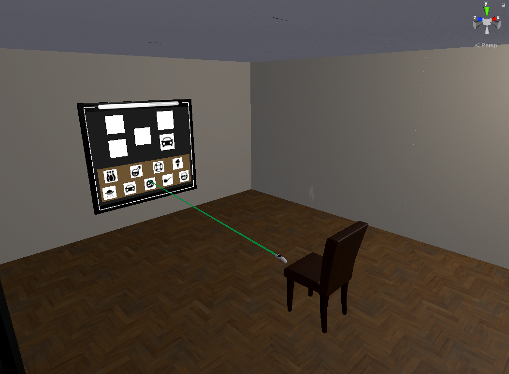

# Memory VR Game (Restorer)
**Open-Source Reconstruction of a Cognitive Memory Task for Eye-Tracking–Based Cognitive Load Assessment**

</img>

## Short Description
**Memory VR Game (Restorer)** is an open-source Unity3D reconstruction of the *Restorer* memory task from the [Neuronation](https://www.neuronation.com/) cognitive training app, adapted for immersive virtual reality.    

The goal of this reconstruction is to provide a controlled, open-source, research-grade memory task suitable for cognitive science, HCI, and VR experimentation. This VR version was developed as part of a research study examining **intrinsic cognitive load** using **non-intrusive eye-tracking indicators**.   

The game presents participants with a grid of objects during a 8-second memorization phase. After this phase, some or all objects disappear, and the participant must recall and fill the empty positions by selecting the correct objects from a set of visual options. The empty position to be filled is indicated by a pulsing animation, and filling order of empty positions is non-sequential. Across 26 levels of increasing complexity, the game induces varying degrees of intrinsic cognitive load by increasing memory and spatial recall demands.   

 To isolate intrinsic load and minimize extraneous cognitive effort, the VR environment was intentionally designed to be minimalistic and distraction-free: a plain room, neutral lighting, and a virtual screen directly in front of the participant. Participants interacted using VR controllers, and all gameplay was preceded by gaze calibration and task familiarization.

 

During gameplay, two main data streams were recorded in real time:

- **Eye-tracking metrics**:  
  Gaze origin, gaze direction, gaze validity, blink status, gaze hit point in 3D space, and the currently viewed virtual object.

- **Task performance metrics**:  
  Level number, task start and end time, duration, selected objects, and correctness.

